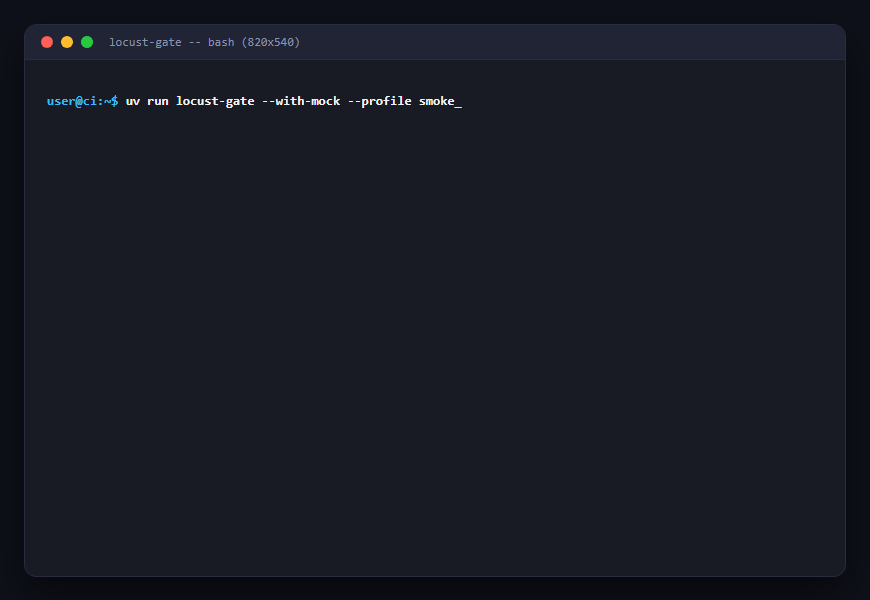
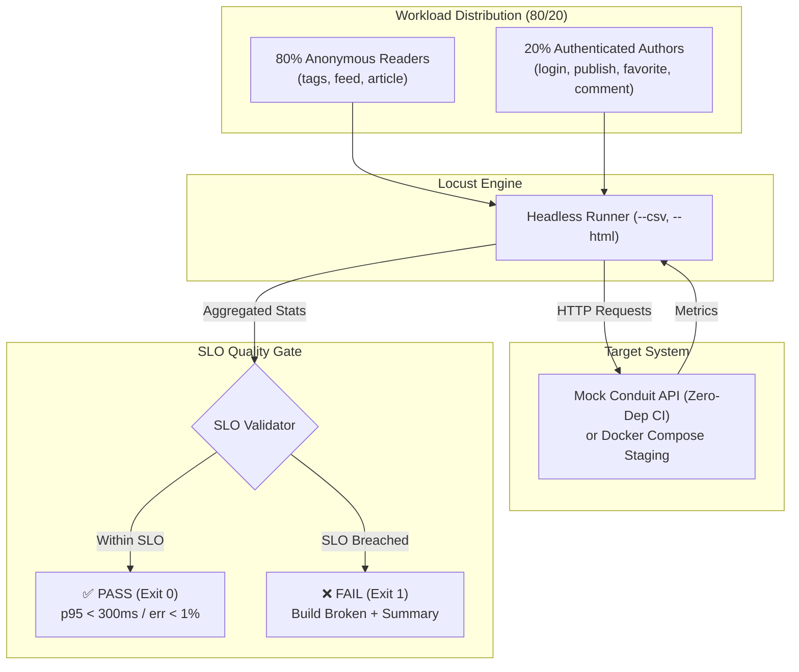
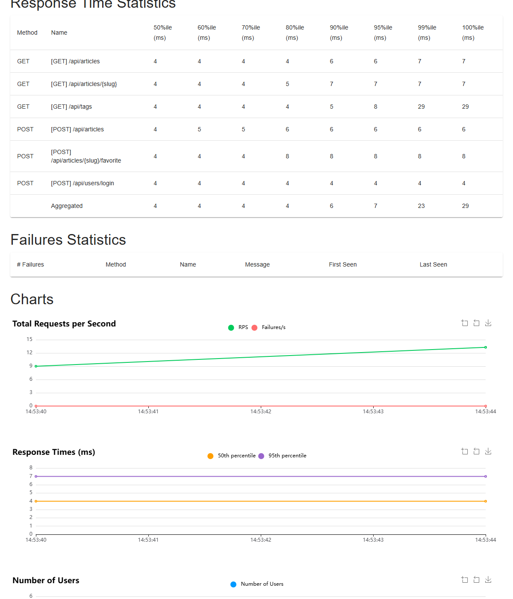
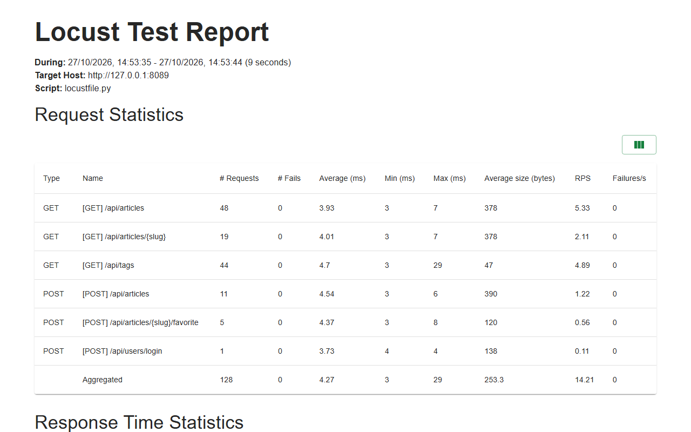

# Locust Performance & SLO Gate Testing Kit (P7)

[](https://github.com/maikonfcosta/locust-perf-kit/actions)


Deterministic performance testing kit with **Locust** in Python 3.12 against the **Conduit REST API**. Implements workload modeling (80/20 reader/author distribution), percentile-based SLO gates (p95 / p99 / error rate), step summary generation for GitHub Actions, and automated **failure injection** to prove the gate blocks when performance degrades.

<p align="center">
  
</p>

---

## 🎯 The Engineering Problem

1. **Averages Lie**: An average latency of 80ms can hide a catastrophic p95 of 1200ms where 5% of users experience broken checkouts or timeouts. Quality gates must enforce percentiles, not arithmetic means.
2. **Unvalidated Quality Gates**: A performance gate in CI that has never failed is not trustworthy. If you cannot induce failure artificially and verify that the build turns red, you are shipping blind optimism.
3. **Flaky Load in Ephemeral CI Runners**: Full-scale multi-minute load tests against remote environments are flaky and costly. CI needs deterministic, sub-minute gates with embedded mock latency control, while preserving real Docker Compose execution for local/staging runs.

---

## 📊 Workload Profiles & Architecture



### User Distribution (80/20 Web Model)
- **80% Anonymous Readers (`AnonymousReaderUser`):** High frequency tag lookups (`GET /api/tags`), global article feed browsing (`GET /api/articles`), and single article inspection (`GET /api/articles/{slug}`).
- **20% Authenticated Authors (`AuthenticatedAuthorUser`):** Login handshake (`POST /api/users/login`), dynamic article publishing with UUID payloads (`POST /api/articles`), favoriting (`POST /api/articles/{slug}/favorite`), and commenting (`POST /api/articles/{slug}/comments`).

### Workload Profiles
| Profile | Target Intent | Concurrency | Spawn Rate | Duration | Gate Acceptance Criteria |
|---|---|:---:|:---:|:---:|---|
| **Smoke** | CI/PR Fast Sanity | 5 users | 2/s | 10s | Error rate = 0%, p95 < 300ms (read) / < 600ms (write) |
| **Load** | Nominal Sustained Traffic | 50 users | 5/s | 30s | Error rate ≤ 1%, p95 < 250ms, aggregate p95 < 300ms |
| **Spike** | Traffic Burst | 100 users | 25/s | 20s | Error rate ≤ 2%, p95 < 500ms |
| **Stress** | Saturation Threshold | 200 users | 10/s | 45s | Identify bottleneck limits before total failure |

---

## 🛡️ SLO Gates & Failure Injection Proof

### Strict Service Level Objectives (SLOs)
- **Error Rate:** Max **1.0%** failures allowed under nominal load.
- **Read Latency (p95):** Max **300ms**.
- **Write Latency (p95):** Max **600ms**.
- **Aggregate Latency (p95):** Max **400ms**.

### Proof of Gate (Failure Injection)
The test suite includes `tests/test_gate_failure.py`, which injects 350ms of artificial latency into the server:
- **Baseline Run:** p95 is ~8ms → **PASS (Exit 0)**.
- **Injected Run:** Server latency pushes p95 to 2200ms → **FAIL (Exit 1)**.
- **Evidence:** Verified by automated tests. The gate reliably breaks the build on SLO violations.

---

## 📈 Visual Reports & Metric Dashboards

Every execution automatically generates self-contained HTML reports (`test-results/report_<profile>.html`) with interactive charts (RPS, response times, percentile distributions, and user concurrency):

<p align="center">
  
</p>

### Aggregated Performance Statistics
<p align="center">
  
</p>

---

## 🚀 Quickstart & Reproduction

### Prerequisites
- Python 3.12+
- `uv` installed (`pip install uv` or via standalone installer)

### 1. Installation
```powershell
# Clone the repository
git clone https://github.com/maikonfcosta/locust-perf-kit.git
cd locust-perf-kit

# Install dependencies in virtualenv
uv sync
```

### 2. Run Quality Checks & Unit Tests
```powershell
# Lint check
uv run ruff check .

# Run test suite including failure injection proof
uv run pytest
```

### 3. Run Headless CLI Performance Gate
```powershell
# Run smoke profile against embedded mock server
uv run locust-gate --with-mock --profile smoke

# Prove the gate blocks by injecting 450ms of latency
uv run locust-gate --with-mock --profile smoke --inject-latency-ms 450
```

### 4. Interactive Web UI Mode
```powershell
# Start mock server in background or start Conduit in Docker Compose
uv run python -c "from locust_perf_kit.mock_server.server import MockConduitServer; import time; s = MockConduitServer(port=8089); s.start(); time.sleep(3600)"

# In another terminal, start Locust web UI
uv run locust --host http://127.0.0.1:8089
# Open http://localhost:8089 in your browser
```

---

## ⚙️ Decisions & Trade-offs

1. **Embedded Mock Server vs. Full Docker in CI:** Running a full database container and app in GitHub Actions free runners introduces unpredictable CPU throttling and disk I/O flakiness. We built a zero-dependency HTTP server with programmable latency (`MockConduitServer`) for sub-second, 100% deterministic CI tests, while retaining standard Conduit compatibility for local Docker runs.
2. **Percentiles over Averages:** Averages discard outliers. In distributed architectures, cold starts, GC pauses, and SQLite write locks manifest exclusively in the 95th and 99th percentiles.
3. **Automated Markdown Step Summaries:** Instead of forcing developers to download raw CSV files or scroll through terminal logs, `locust-gate` outputs formatted Markdown tables directly into `$GITHUB_STEP_SUMMARY`.

---

## 🇧🇷 Documentação em Português

Kit determinístico de testes de performance com **Locust** em Python 3.12 contra a **Conduit REST API**.

### Por que p95 e não média?
A média aritmética mascara lentidões críticas. Se 95 requisições respondem em 10ms e 5 requisições demoram 3000ms, a média aponta ~159ms (parece aceitável), enquanto 5% dos seus usuários sofreram timeouts graves. O gate avalia o percentil 95 (p95), garantindo que 95% do tráfego responda abaixo do limiar estipulado.

### Prova do Gate (Injeção de Falhas)
Um gate de qualidade só é confiável se você puder provar que ele barra o pipeline quando uma falha ocorre. Este projeto inclui o teste automatizado `test_gate_failure.py`, que injeta atraso artificial e valida a rejeição imediata com código de saída 1.
